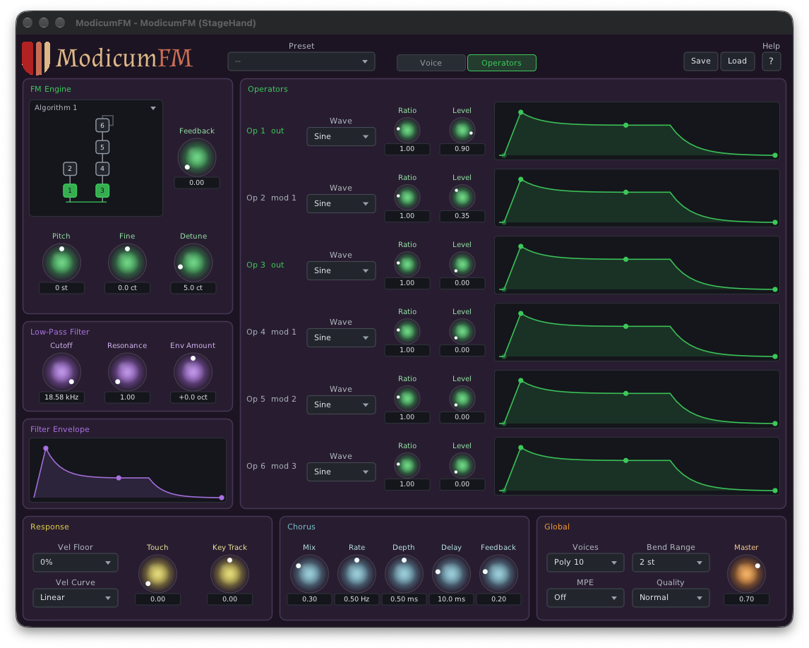

# ModicumFM

A 6-operator FM synth from Unlikelyware that hides FM's complexity behind role-based macros
(Brightness, Bite, Grit, Body), with the full operator panel for when you want it. The 32 DX7
algorithms, stereo detune, a resonant filter and a chorus.



| | |
|---|---|
| Formats | CLAP. VST3 and AUv2 (macOS) build from source; ready-built in a later preview |
| Platforms | Linux x86-64, macOS 26 or later on Apple Silicon. No Windows |
| Version | 0.9.0 (preview) |
| License | MIT |

**Downloads:** ready-built plugins will be on itch.io with the 0.9 preview. This repo has the
source only.

## What makes it different

- **Macros by role.** Brightness, Bite, Grit and Body act on the operators by what they do in the
  current algorithm, so the same knob makes sense in every patch. Shared loudness and brightness
  envelopes scale every operator's envelope at once, and Realism gives each note its own small
  pitch and index offset.
- **The expert view is still there.** Six operators with their own waves, ratios and delay-ADSR
  envelopes edited as graphs, and the algorithm drawn as a diagram that labels each operator's
  role.
- **Expression built in.** Pressure and timbre can brighten, open the filter or swell the level,
  per note.
- **MIDI 2.0 first.** The plugin takes MIDI 2.0 notes directly, so a Pitch 7.9 note plays its exact
  microtonal pitch, not the nearest semitone: an EDO keyboard such as
  [KeyboardEDO](https://github.com/erickampman/KeyboardEDO) is heard as played. Per-note pitch bend,
  Pitch 7.25 and per-note controllers reach only the note they name. MIDI 1.0 works too.
- **MPE and CLAP note expressions.** An MPE switch for MPE controllers, and in hosts that send CLAP
  notes (Bitwig) tuning, pressure and brightness arrive per note.

About 25 factory presets, from E.Piano and Tubular Bells to Harmonica and Gong. The
[help page](Resources/help.md), also behind the editor's Help button, describes every control.
[docs/how-it-works.md](docs/how-it-works.md) has the engine and the MIDI 2.0 details;
[docs/ROADMAP.md](docs/ROADMAP.md) what's planned.

## Installing

The download holds `ModicumFM.clap`. Put it in your CLAP folder (create the folder if it isn't there),
then rescan plugins in your host:

| | Linux | macOS |
|---|---|---|
| For you | `~/.clap` | `~/Library/Audio/Plug-Ins/CLAP` |
| For every user | `/usr/lib/clap` | `/Library/Audio/Plug-Ins/CLAP` |

On macOS, `~/Library` is hidden in Finder: Go ▸ Go to Folder opens it. The 0.9 previews aren't
notarized, so macOS won't load a downloaded plugin until its quarantine flag is cleared:

```bash
xattr -dr com.apple.quarantine ~/Library/Audio/Plug-Ins/CLAP/ModicumFM.clap
```

A host that is already running keeps the plugins it loaded: quit and restart it. To build ModicumFM
yourself instead, see below.

## Building from source

```bash
git clone https://github.com/erickampman/ModicumFM.git
cd ModicumFM
tools/fetch_deps.sh
cmake -B build -G Ninja -DCMAKE_BUILD_TYPE=Release
cmake --build build
```

[BUILDING.md](BUILDING.md) has what to install first on Linux and macOS, the tests, installing
the plugin for hosts, and the build options.

## Help and bugs

Questions and bug reports go to [GitHub Issues](https://github.com/erickampman/ModicumFM/issues).

## License

MIT. See [LICENSE](LICENSE) and [THIRD_PARTY_NOTICES.md](THIRD_PARTY_NOTICES.md).
